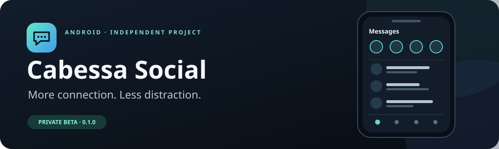

<strong>סטורי. הודעות. פוסטים מהנעקבים. סרטון אחד בכל פעם.</strong>

  
  
  
  

<a href="docs/INSTALL_HE.md">התקנה ועדכון</a> · <a href="docs/BUILD_RESULT_HE.md">תוצאות הבנייה</a> · <a href="docs/BUILD_FROM_SOURCE.md">Build from source</a> · <a href="CHANGELOG.md">שינויים</a>

## גרסה 0.1.6 — עיצוב הכפתורים ותיקון הנגן המבודד

**APK 0.1.6 נבנה ונחתם עם אותה זהות חתימה של הגרסאות הקודמות.** הכפתורים
במסך הבית, בניהול הפיד, בהגדרות ובנגן קיבלו שפה חזותית עקבית עם Instagram:
פעולה ראשית כחולה, משטחים ניטרליים, אייקוני קו, פינות מתונות ואזורי לחיצה
של לפחות 48dp. התצוגה מותאמת למצב בהיר וכהה, לעברית ולמסכים צרים או לגופן מוגדל.

הנגן נפתח במסך עצמאי אטום (Activity). הוא ממתין לעצירת מסך המקור לפני
חיפוש המדיה ולפני תחילת הניגון. המנגנון נועד לעצור את התקדמות הסטורי ואת
הקול שלו בזמן הצפייה; בדיקת הסטורי האמיתי בטלפון עדיין נדרשת.
מחזור החיים של הנגן מטפל במעבר לרקע, בחזרה למסך, בשינוי תצורה ובתגובות טעינה
מאוחרות. תוקנו גם שימור המיקוד לאחר יצירת המסך מחדש, מרווחי הנגן סביב פסי
המערכת וכיוון התצוגה כאשר שפת האפליקציה שונה משפת התהליך.

| אימות 0.1.6 | מצב |
| --- | --- |
| בדיקות מקור ושערי שחרור, מקומית וב־CI | 29 מתוך 29 עברו |
| תרחישי מחזור חיים וניגון ב־Android ממשי באמולטור | 8 מתוך 8 עברו |
| תצוגות ממשק באנגלית ובעברית, במצב בהיר וכהה | 24 בתצוגה רגילה ו־24 במסך צר עם גופן מוגדל עברו |
| הרצת CI מלאה | [עברה בהצלחה](https://github.com/dvicabi/Projects/actions/runs/45797367424) |
| שימוש בחשבון Instagram מחובר בטלפון | טרם נבדק |

תוצאות האמולטור מבוססות על מסכי הייצור ועל סרטון בדיקה מקומי, ללא חשבון
Instagram. הן בודקות התנהגות אמיתית של Android אך אינן מחליפות בדיקת הסטורי
של השירות בחשבון מחובר. [רשומת הפרסום של 0.1.6](release/0.1.6-PUBLICATION.md)
מרכזת את מצב ה־CI העדכני ואת ראיות הקובץ; [דוח הבנייה](docs/BUILD_RESULT_HE.md)
מפרט את הבדיקות והמגבלות.

## היסטוריה: גרסה 0.1.5 — ניהול חשבונות מוסתרים

כפתור **ניהול הפיד · הסתרת חשבונות** במסך הבית ובהגדרות פותח רשימת חשבונות
שהופיעו בפיד לאחרונה, אפשרות להוסיף שם משתמש ידנית ורשימת החרגות שניתן לבטל.
ההחרגות נשמרות מקומית במכשיר, לפי מזהה חשבון כשהוא זמין. הן אינן מבטלות מעקב
ואינן חלות על סטורי, הודעות ופרופילים. יש לרענן את הפיד אחרי שינוי; פריטים ישנים
במטמון עלולים להופיע עד לקבלת תשובה חדשה. הסדר וההמשך של פיד הנעקבים נשמרים.

22 בדיקות JVM/Python עברו (12 בדיקות מקור ו־10 בדיקות שערי Release).
**APK 0.1.5 נבנה ונחתם ב־26 בנובמבר 2026 עם אותה זהות חתימה.** בדיקות שימוש בפועל במכשיר נותרו פתוחות. ראו [פרטי המימוש, הפרטיות והמגבלות](docs/FEED_EXCLUSIONS.md).

## היסטוריה: גרסה 0.1.4 — תצוגה מקדימה של קוד המקור בלבד

נוספה בקוד פתיחת Reel ששיתפו בתוך סטורי באמצעות נגן הסרטון הבודד הקיים.
החיבור ממוקד בנתיב השיתוף הרגיל מסוג CLIPS, ובוחר את מזהה ה־Reel שהפעולה
המקורית משתמשת בו. יתר פעולות הסטורי נשארות ללא שינוי. אין פתיחת נגן Reels
מקורי כנתיב חלופי במקרה של כשל.

21 בדיקות אוטומטיות עברו. נתיב הסטורי נבדק סטטית מול ה־APK הקיים.
גרסה 0.1.4 הייתה תצוגת מקור בלבד; השינויים כלולים בגרסה 0.1.5 החתומה. [דוח השינוי והבדיקות](docs/STORY_SHARED_REEL.md).

## היסטוריה: גרסה 0.1.3 — גרסה חתומה קודמת

עדכון APK נבנה ונחתם ב־25 בנובמבר 2026 עם אותו אישור חתימה של הגרסה
הקודמת. הוא משלב שתי תוספות שהתבקשו:

| תוספת | התנהגות |
| --- | --- |
| פיד פרסומי הנעקבים | כפתור במסך הסטורי וההודעות פותח Following, עם טעינת המשך טבעית וסדר חדש לישן לפי השירות. בחירת המצב נאכפת גם בשלב כתיבת פרמטרי הבקשה הסופיים. |
| Reel שנשלח בהודעה | נגן מסך מלא בסגנון סטורי לסרטון שנבחר בלבד. השהיה, ניגון חוזר, מעבר בתוך הסרטון וחזרה לשיחה. אין סרטון הבא. |

הגרסה כוללת מימוש וקובץ התקנה. ניגון בפועל וסדר התוכן בחשבון אמיתי עדיין
דורשים בדיקה בטלפון. המשתמש אישר שההתחברות בגרסה הקודמת עובדת; מנגנון
ההתחברות ומפתח החתימה נשמרו. המקורות הם מקורות השינויים וכלי הבנייה,
ולא קוד המקור הקנייני של Instagram.

## מה נשאר ומה מוגבל

| נשאר באפליקציה | מגבלות קבועות |
| --- | --- |
| הודעות פרטיות וקבוצות, צפייה והעלאת סטורי | Notes ו־Explore חסומים |
| חיפוש אנשים, פרופילים ופוסטים | פיד אלגוריתמי והמלצות חסומים לפי כללי הסינון |
| העלאת פוסטים, לייקים, תגובות והתראות | אין גלילת Reels או מעבר אוטומטי לסרטון הבא |
| פיד נעקבים עם טעינת פוסטים ישנים | אין Ghost Mode או פתיחת חסימות לזמן מוגבל |
| נגן מבודד ל־Reel מהשיחה ומצב שחור ולבן | אין מנגנון עדכון חיצוני או ממשק Debug |

בנגן החדש יש פעולות ניגון בלבד; כפתורי לייק, תגובה ושיתוף של Reel אינם
כלולים בו. הפרסומים בפיד הם התוכן הזמין שאינסטגרם מחזירה לחשבון הנעקבים;
אין הבטחה לארכיון מלא או לשחזור סטוריז שפג תוקפם.

## התקנת גרסה 0.1.6

הורד את `cabessa-social-0.1.6.apk` שנמסר לבעל הפרויקט ופתח בטלפון כעדכון מעל
Cabessa Social הקיימת. אין צורך להסיר את האפליקציה או לנקות נתונים.
ה־APK נמסר בנפרד מחבילת המקורות. הקובץ החתום נמסר בנפרד ואינו מפורסם במאגר המקור הציבורי.

| פריט | ערך |
| --- | --- |
| גרסת Cabessa Social | `0.1.6` |
| גרסת בסיס Instagram | `456.0.0.53.78` |
| חבילת Android | `com.dvircab.social` |
| התאמה | Android 9+ · ARM64 |
| גודל APK | 170884084 בתים |
| Commit של קוד הייצור שנבנה | `19e3135eca3d062e4d8cc96147411409c5762e3f` |
| APK SHA-256 | `8853331a7899bd84eb3ad28e3b89379ee283f6706d34aa269055b45c8ece7752` |
| אישור חתימה SHA-256 | `8c0c5bde8ad2a9cc174b5385ae1a24734f95b07f4f6d751fcff2a82280066dc2` |
| ראיות הבנייה ומצב ה־CI | [רשומת הפרסום של 0.1.6](release/0.1.6-PUBLICATION.md) |

## תוצאות הבנייה ההיסטורית של 0.1.3

| בדיקה | תוצאה |
| --- | --- |
| קומפילציית Java ו־Kotlin | 29 קובצי Java ו־20 קובצי Kotlin עברו |
| החלת השינויים על APK הבסיס | 16 שינויים הוחלו, ללא כשל |
| בדיקות אוטומטיות | 21 בדיקות עברו |
| אישור חתימה, חבילה ויישור APK | עברו; אותה זהות חתימה |
| שימוש בטלפון בגרסה החדשה | טרם נבדק |
| בדיקת תעבורת רשת מלאה | טרם בוצעה |

## מבנה המקורות

| תיקייה | תוכן |
| --- | --- |
| `extensions/` | Java: מדיניות, מסכים, נגן וטעינת מדיה |
| `patches/` | Kotlin: חיבור השינויים לקוד APK הבסיס |
| `scripts/` | בנייה, אימות כלי עבודה ובדיקת תוצאות |
| `tests/` | בדיקות התנהגות, בקשות ומחזור חיים |
| `release/` | ראיות בנייה לפי גרסה, כולל 0.1.6, אישור ציבורי וחבילת השינויים |
| `release/history/` | ראיות הגרסה המקורית לצורכי היסטוריה |
| `docs/` | התקנה, בנייה, ארכיטקטורה ומגבלות |

## מדיניות ותחזוקה

החסימות מקובעות בקוד. [מדיניות הרשת](docs/NETWORK_POLICY.md) מפרטת את
החסימה של נתיבי טלמטריה מוכרים ואת ההרשאה המצומצמת לסרטון שנבחר.
אין טענה לאפס איסוף נתונים. ההתחברות והתעבורה הדרושה לשירות נשארות
במסלול המקורי של Instagram. עקיפת אמון בחתימה לא הופעלה.

[הנגן המבודד](docs/SINGLE_SHARED_REEL_DESIGN.md) ו[פיד החברים](docs/FRIENDS_POSTS.md)
מתעדים את נקודות החיבור שאומתו בקוד ואת בדיקות המכשיר שנותרו. שינוי של
Instagram או של תבנית הודעה/מדיה עשוי לדרוש התאמה. פרטי הבנייה וכלי העבודה
נעולים ב[הוראות הבנייה](docs/BUILD_FROM_SOURCE.md). מפתחות חתימה וסיסמאות
אינם כלולים במקורות או בקובץ ההתקנה.

## קרדיט ורישיון

מבוסס על [FeurStagram](https://github.com/jean-voila/FeurStagram).
מקורות השינויים כפופים ל־[GPLv3](LICENSE), עם [NOTICE](NOTICE) המקורי.
Instagram היא רכיב נפרד וקנייני. זהו שינוי אישי בלתי רשמי, ללא שיוך ל־Meta.
מסמכי upstream ועיצוב היסטורי נשמרו לצורכי קרדיט והיסטוריה.
